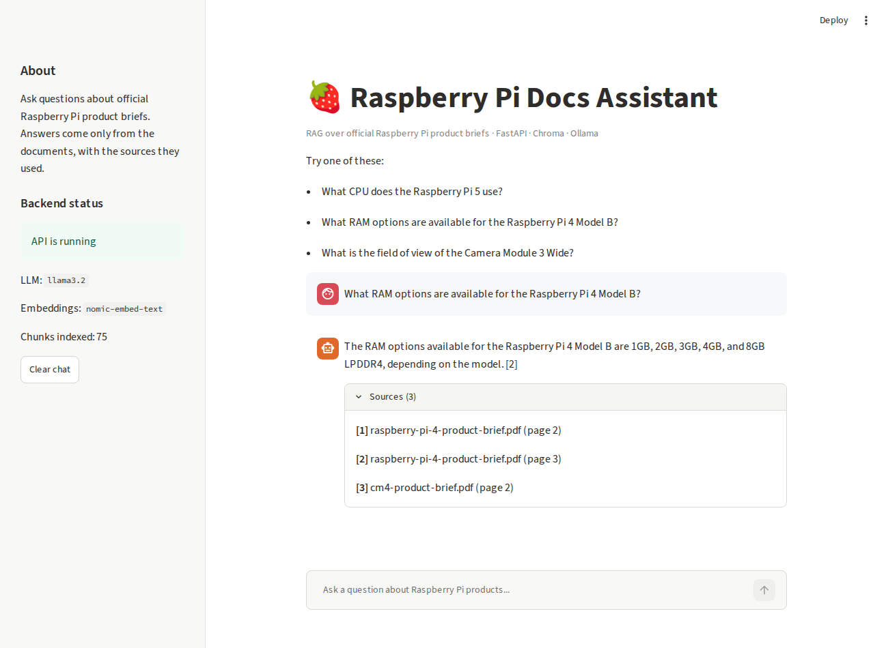
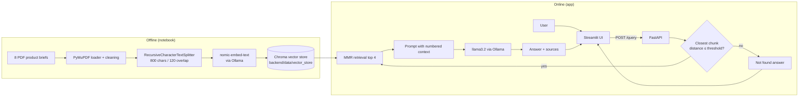
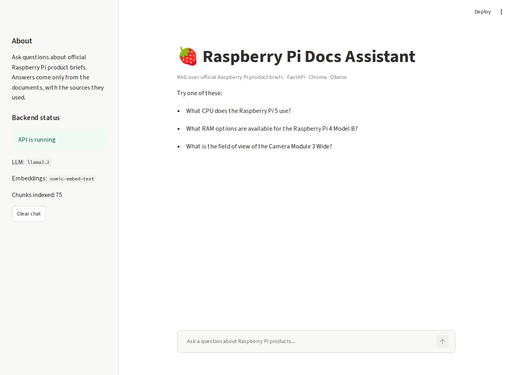
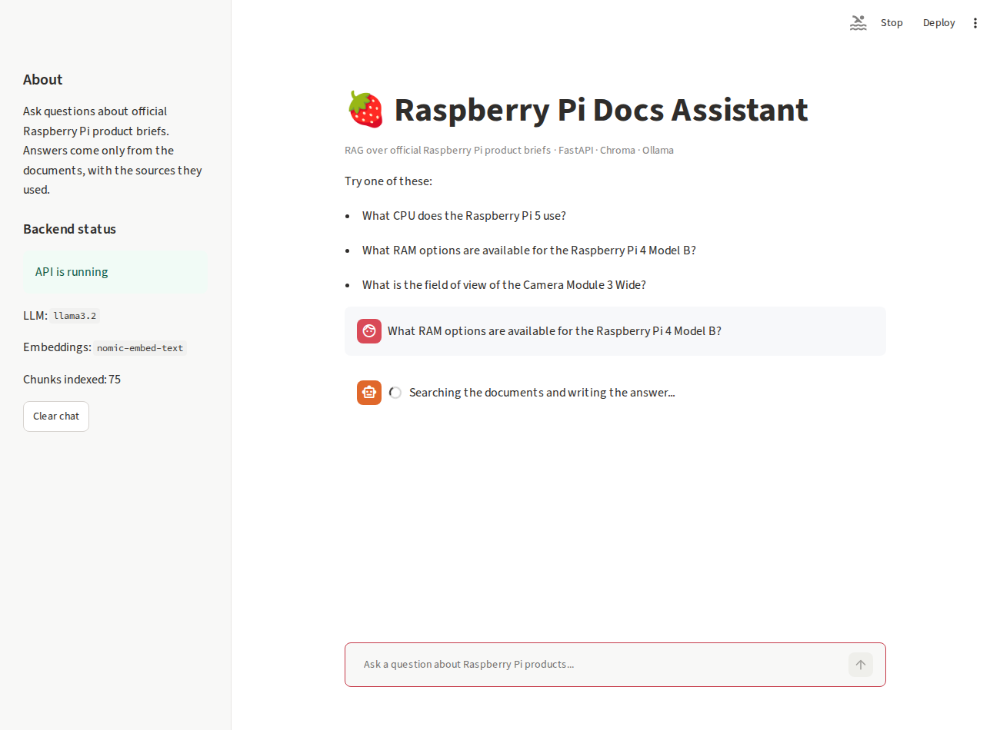
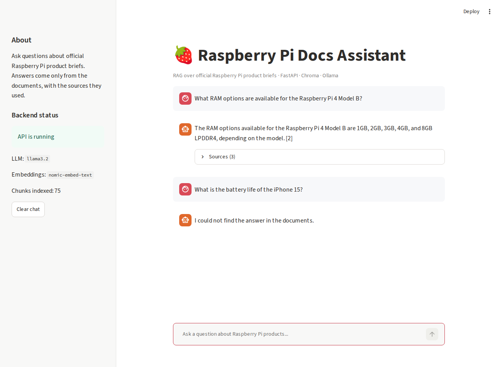
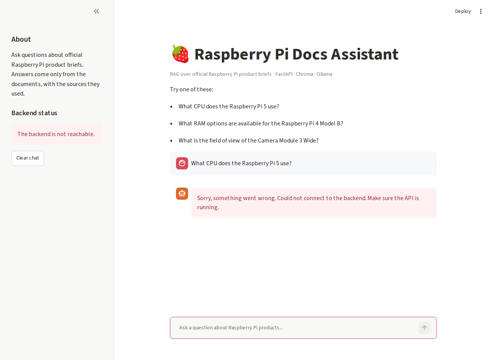
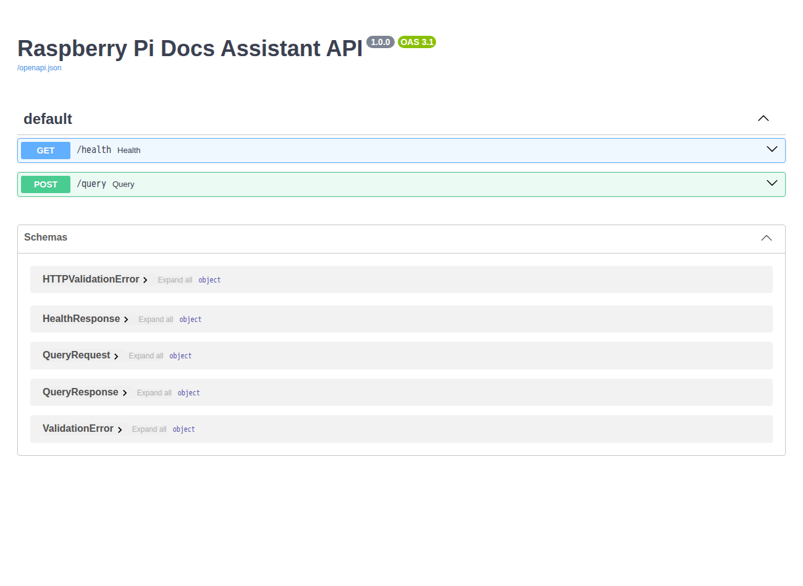

# Raspberry Pi Docs Assistant — RAG-Powered Document Assistant

A local RAG (Retrieval-Augmented Generation) web app that answers questions about Raspberry Pi products
using **only** the official Raspberry Pi product briefs, and shows the file and page every answer came from.
Everything runs locally: embeddings and the LLM are served by [Ollama](https://ollama.com), the vector store is
Chroma, the API is FastAPI and the UI is Streamlit.

> ITI Level 2 Summer Training — Graduation Project (Core Track) · Abdelrahman Hesham



## Overview

- **Notebook** (`notebooks/rag_pipeline.ipynb`) — loads and cleans 8 PDFs, chunks them, embeds the chunks,
  stores them in a persisted Chroma vector store, tests retrieval, evaluates answers on 14 questions and
  exports the vector store for the backend.
- **Backend** (`backend/`) — FastAPI service with `GET /health` and `POST /query`. The vector store and the
  LLM client are loaded once at startup (lifespan). Questions that are far from every chunk are answered
  with "not found" without calling the LLM.
- **Frontend** (`frontend/`) — Streamlit chat UI that shows the answer, its numbered sources, a loading
  state and friendly error messages. The backend URL comes from an environment variable.

## Architecture



## Tech stack

| Part | Tools |
|---|---|
| Language | Python 3.10+ |
| LLM & embeddings | Ollama · `llama3.2` (3B) · `nomic-embed-text` (768-dim) |
| RAG framework | LangChain (`langchain-ollama`, `langchain-chroma`, `langchain-text-splitters`, `langchain-community`) |
| Vector store | Chroma (persisted to disk, cosine distance) |
| PDF parsing | PyMuPDF (compared with pypdf in the notebook) |
| Backend | FastAPI · Uvicorn · Pydantic / pydantic-settings · pytest + TestClient |
| Frontend | Streamlit · requests · python-dotenv |
| Packaging | Docker (backend) |

## Project structure

```
rag-assistant-app/
├── data/
│   ├── sources.csv              # file name, product, official URL for each PDF
│   ├── download_data.py         # downloads the PDFs into data/raw/
│   └── raw/                     # PDFs (git-ignored)
├── notebooks/
│   ├── rag_pipeline.ipynb       # build + evaluate the RAG pipeline, export the vector store
│   └── requirements.txt
├── backend/
│   ├── app/
│   │   ├── main.py              # FastAPI app, CORS, lifespan loading
│   │   ├── api/routes/query.py  # GET /health, POST /query
│   │   ├── core/config.py       # settings from .env
│   │   ├── schemas/query.py     # QueryRequest / QueryResponse
│   │   ├── services/
│   │   │   ├── retrieval.py     # load Chroma, relevance check, MMR retrieval
│   │   │   └── generation.py    # prompt + Ollama LLM
│   │   └── utils/logging_config.py
│   ├── data/vector_store/       # exported by the notebook (≈1 MB, committed)
│   ├── tests/test_query.py
│   ├── requirements.txt
│   ├── .env.example
│   └── Dockerfile
├── frontend/
│   ├── app.py                   # Streamlit chat UI
│   ├── api_client.py            # calls the backend
│   ├── .env.example
│   └── requirements.txt
└── docs/screenshots/
```

## Domain & data

The documents are the official **Raspberry Pi product briefs** (public PDFs from
`datasheets.raspberrypi.com`), listed in [`data/sources.csv`](data/sources.csv):

| Product | File |
|---|---|
| Raspberry Pi 5 | raspberry-pi-5-product-brief.pdf |
| Raspberry Pi 4 Model B | raspberry-pi-4-product-brief.pdf |
| Raspberry Pi 400 | raspberry-pi-400-product-brief.pdf |
| Raspberry Pi Zero 2 W | raspberry-pi-zero-2-w-product-brief.pdf |
| Raspberry Pi Compute Module 4 | cm4-product-brief.pdf |
| Raspberry Pi Pico | pico-product-brief.pdf |
| Raspberry Pi Pico 2 | pico-2-product-brief.pdf |
| Raspberry Pi Camera Module 3 | camera-module-3-product-brief.pdf |

- 8 PDFs, 58 pages, all text-based (no OCR needed). 24 pages are covers, dimension drawings or keyboard layouts
  with almost no text and are dropped during cleaning → 31 pages, ~41.6k characters.
- Cleaning: value-only lines (`2034`, `$80`) are joined to their label, drawing/keyboard noise is removed, and
  real tables (e.g. Camera Module 3 variants) are also written as one line per row.
- Chunking: 800 characters with 120 overlap → **75 chunks**, each prefixed with `Product: <name>`.

The PDFs are not committed. Get them with `python data/download_data.py` (the notebook also downloads any
missing file).

## Setup

### 1. Prerequisites

| Tool | Version | Check |
|---|---|---|
| Python | 3.10+ | `python --version` |
| Ollama | latest | `ollama --version` |
| Git | any | `git --version` |

Pull the two models once:

```bash
ollama pull llama3.2
ollama pull nomic-embed-text
```

### 2. Clone

```bash
git clone https://github.com/Aboood775/rag-assistant-app.git
cd rag-assistant-app
```

### 3. Backend

```bash
cd backend
python -m venv .venv
.venv\Scripts\activate          # Windows
# source .venv/bin/activate     # macOS / Linux
pip install -r requirements.txt
copy .env.example .env          # Windows  (cp .env.example .env on macOS / Linux)
uvicorn app.main:app --reload
```

Open <http://localhost:8000/docs> to try the API from Swagger UI. Run the tests with:

```bash
pytest -v
```

### 4. Frontend (new terminal)

```bash
cd frontend
python -m venv .venv
.venv\Scripts\activate
pip install -r requirements.txt
copy .env.example .env
streamlit run app.py
```

Open <http://localhost:8501> and ask a question.

### 5. Rebuild the vector store (optional)

The exported vector store is already in `backend/data/vector_store/`. To rebuild it from the PDFs:

```bash
pip install -r notebooks/requirements.txt
python data/download_data.py
cd notebooks
jupyter notebook rag_pipeline.ipynb      # Kernel → Restart & Run All
```

### Docker (backend)

```bash
cd backend
docker build -t rag-assistant-api .
docker run -p 8000:8000 rag-assistant-api
```

The container reaches Ollama on the host through `http://host.docker.internal:11434`.

## Environment variables

**Backend** (`backend/.env`)

| Variable | Default | Description |
|---|---|---|
| `VECTOR_STORE_DIR` | `data/vector_store` | Folder exported by the notebook |
| `OLLAMA_BASE_URL` | `http://localhost:11434` | Ollama server |
| `LLM_MODEL` | `llama3.2` | Chat model used for answers |
| `LLM_TEMPERATURE` | `0` | Sampling temperature |
| `LLM_MAX_TOKENS` | `300` | Max tokens per answer |
| `TOP_K` | `4` | Chunks sent to the LLM |
| `FETCH_K` | `20` | Candidates considered by MMR |
| `LAMBDA_MULT` | `0.9` | MMR relevance/diversity balance |
| `MAX_DISTANCE` | from `config.json` | Optional override of the out-of-scope threshold |
| `CORS_ORIGINS` | `http://localhost:8501` | Allowed frontend origins (comma separated) |
| `LOG_LEVEL` | `INFO` | Logging level |

The embedding model and collection name are read from `backend/data/vector_store/config.json`, so the API
always queries with the same embedding model that built the store.

**Frontend** (`frontend/.env`)

| Variable | Example | Description |
|---|---|---|
| `API_BASE_URL` | `http://localhost:8000` | Backend URL (required, never hard-coded) |

## API reference

### `GET /health`

```bash
curl http://localhost:8000/health
```

```json
{
  "status": "ok",
  "ollama": "up",
  "llm_model": "llama3.2",
  "embedding_model": "nomic-embed-text",
  "chunks_indexed": 75
}
```

### `POST /query`

Request body: `{"question": "string (3–500 chars)"}` → response: `{"answer": "string", "sources": ["string"]}`

```bash
curl -X POST http://localhost:8000/query \
  -H "Content-Type: application/json" \
  -d '{"question": "What CPU does the Raspberry Pi 5 use?"}'
```

```json
{
  "answer": "The Raspberry Pi 5 uses a Broadcom BCM2712 2.4GHz quad-core 64-bit Arm Cortex-A76 CPU. [1]",
  "sources": [
    "raspberry-pi-5-product-brief.pdf (page 2)",
    "raspberry-pi-5-product-brief.pdf (page 3)"
  ]
}
```

| Status | When |
|---|---|
| 200 | Answer returned (an out-of-scope question returns the "not found" answer with no sources) |
| 422 | Missing `question`, wrong type, or fewer than 3 / more than 500 characters |
| 503 | Ollama is not reachable |

## Evaluation results

From section 2.6 of the notebook (14 questions: 12 answerable, 2 out of scope).

| # | Question | Retrieved source | Answer (short) | Correct |
|---|---|---|---|---|
| 1 | What CPU does the Raspberry Pi 5 use and how fast is it? | raspberry-pi-5 (p.2) | Quad-core Arm Cortex-A76 at 2.4GHz | ✅ |
| 2 | What RAM options are available for the Raspberry Pi 4 Model B? | raspberry-pi-4 (p.2) | 1GB, 2GB, 3GB, 4GB, 8GB LPDDR4 | ✅ |
| 3 | Operating temperature range of the Raspberry Pi Zero 2 W? | raspberry-pi-zero-2-w (p.4) | -20°C to +70°C | ✅ |
| 4 | GPIO pins on the Pico, and how many are analogue? | pico (p.2) | 26 GPIO, 3 analogue inputs | ✅ |
| 5 | Which image sensor is used in the Camera Module 3? | camera-module-3 (p.2) | Sony IMX708, 12 MP | ✅ |
| 6 | Diagonal field of view of the Camera Module 3 Wide? | camera-module-3 (p.5) | 102° (should be 120°) | ❌ |
| 7 | How much does the Raspberry Pi 400 kit cost? | raspberry-pi-400 (p.4) | $80 | ✅ |
| 8 | What power input does the Raspberry Pi 5 need? | raspberry-pi-5 (p.2) | 5V/5A DC via USB-C with PD | ✅ |
| 9 | Until when will the Raspberry Pi 4 Model B stay in production? | raspberry-pi-4 (p.3) | At least January 2034 | ✅ |
| 10 | What wireless connectivity does the Pico 2 W offer? | pico-2 (p.2) | 2.4GHz 802.11n + Bluetooth 5.2 | ✅ |
| 11 | Operating temperature range of the Compute Module 4? | cm4 (p.2) | -20°C to +85°C (-40°C extended variants) | ✅ |
| 12 | Does the Raspberry Pi 5 have a real-time clock? | raspberry-pi-5 (p.2) | Yes, RTC with external battery | ✅ |
| 13 | What is the battery life of the iPhone 15? *(out of scope)* | — | "I could not find the answer in the documents." | ✅ |
| 14 | How do I install Windows 11 on a gaming laptop? *(out of scope)* | — | "I could not find the answer in the documents." | ✅ |

**Relevant context: 14/14 · Correct answers: 13/14 (93%)** · ~70 s per answer on a CPU-only runtime.

Main failures found while building it, and the fixes (details in the notebook, section 2.6):

- Value-only lines (`2034`, `$80`) were deleted by the first cleaning → the model hallucinated "2030". Fixed by joining them to their label.
- Tables came out one cell per line → wrong price / "not found". Fixed with PyMuPDF `find_tables` + one line per row.
- MMR with λ=0.7 returned safety text instead of the Zero 2 W spec → wrong temperature. Fixed with λ=0.9.
- Out-of-scope questions → a cosine-distance threshold (0.38) answers "not found" without calling the LLM.
- Remaining: the 3B model reads the wrong row of the Camera Module 3 table (102° instead of 120°).

## Screenshots

| Home | Loading |
|---|---|
|  |  |

| Answer with sources | Out-of-scope question |
|---|---|
|  |  |

| API down (friendly error) | Swagger UI |
|---|---|
|  |  |
